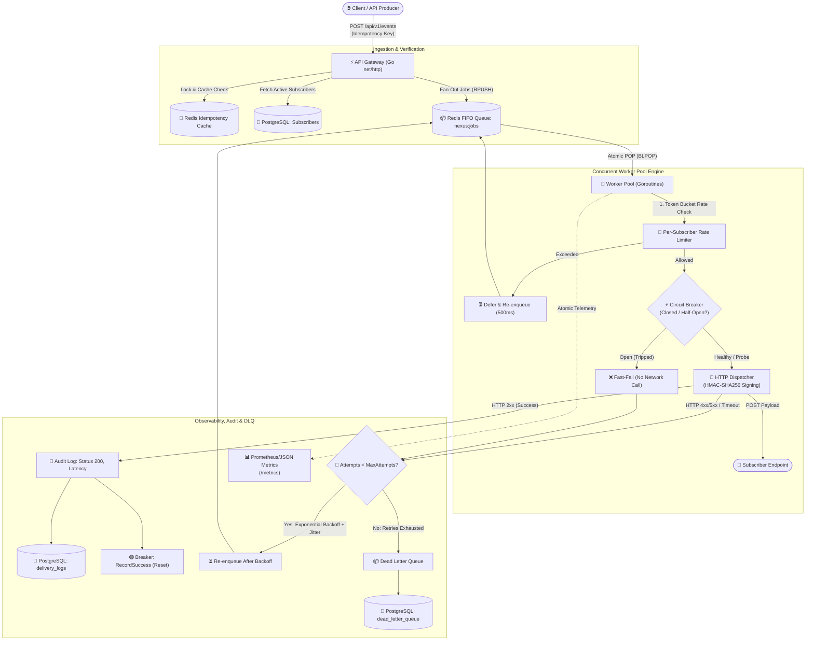
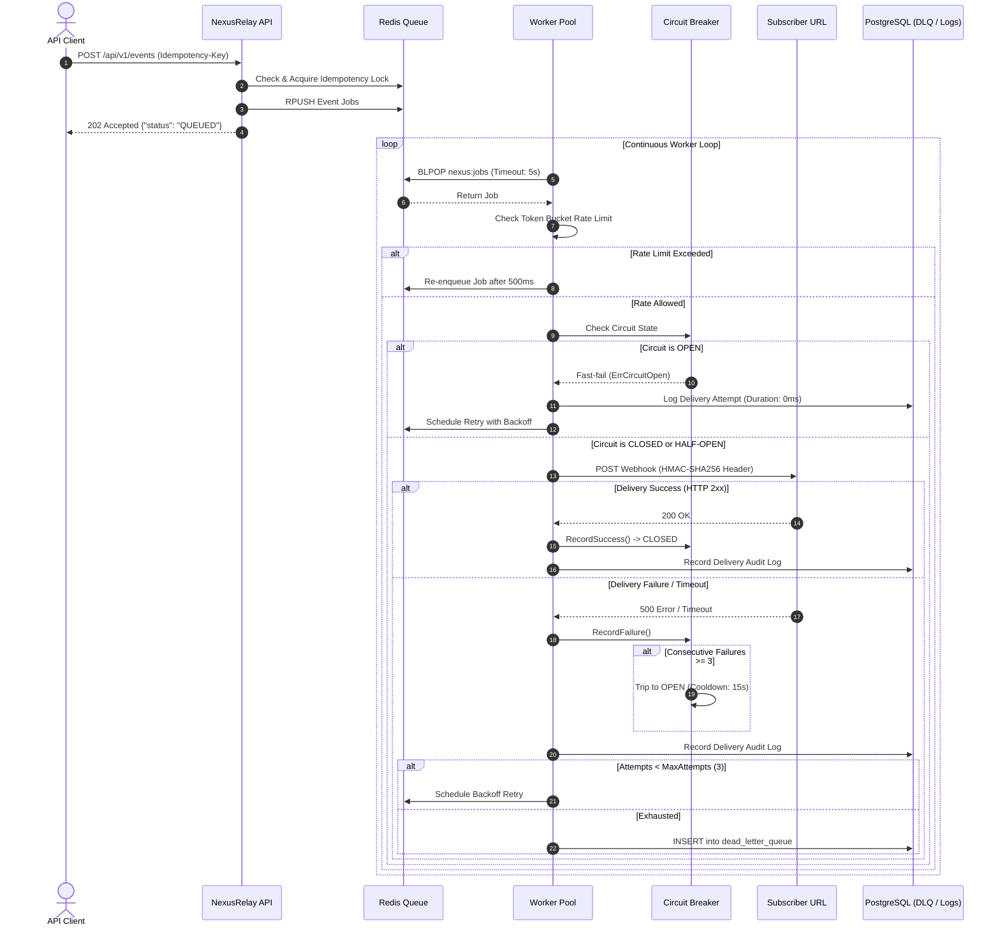
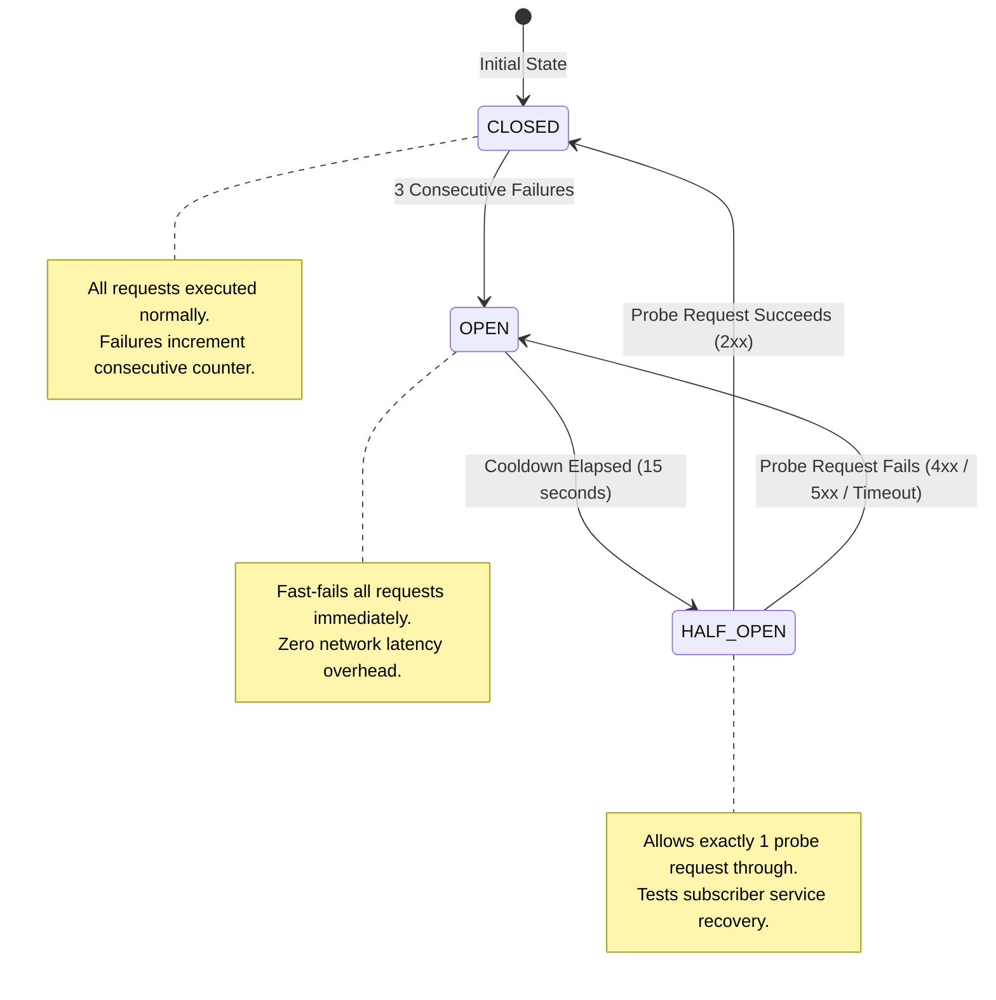

# NexusRelay ⚡

[](https://golang.org)
[](https://www.postgresql.org/)
[](https://redis.io/)
[](https://www.docker.com/)
[](LICENSE)

> **High-Performance, Fault-Tolerant, Distributed Webhook Dispatch & Event Orchestration Engine written in Go.**

NexusRelay is engineered to handle enterprise-grade webhook delivery with sub-millisecond ingestion latency, guaranteed at-least-once delivery semantics, distributed rate limiting, resilient circuit breaking, cryptographic HMAC payload verification, and automated Dead Letter Queue (DLQ) failover.

---

## 📑 Table of Contents

- [System Architecture](#-system-architecture)
- [Key Features](#-key-features)
- [Delivery Pipeline & Flow](#-delivery-pipeline--flow)
- [Circuit Breaker State Machine](#-circuit-breaker-state-machine)
- [Benchmark & Performance Analysis](#-benchmark--performance-analysis)
- [Web Visualizer Dashboard](#-web-visualizer-dashboard)
- [API Reference](#-api-reference)
- [Webhook Security & Verification](#-webhook-security--verification)
- [Configuration Reference](#-configuration-reference)
- [Quick Start Guide](#-quick-start-guide)
- [Project Directory Layout](#-project-directory-layout)
- [License](#-license)

---

## 🏛 System Architecture

NexusRelay separates synchronous ingestion from asynchronous worker dispatching using a Redis-backed queue coupled with durable PostgreSQL storage for subscriber registries, delivery audit logs, and dead-letter queues.



---

## ✨ Key Features

| Capability | Technical Implementation | Value |
| :--- | :--- | :--- |
| **Sub-Millisecond Ingestion** | Go `net/http` + Redis `RPUSH` / pipeline | Accepts spikes of thousands of events/sec without blocking upstream producers |
| **Strict Idempotency** | Redis `SETNX` distributed locks with 24-hr TTL | Guarantees duplicate requests return cached results with zero duplicate dispatch |
| **Token Bucket Throttling** | `golang.org/x/time/rate` per subscriber | Prevents denial-of-service on downstream webhook recipients |
| **3-State Circuit Breaker** | `CLOSED` $\rightarrow$ `OPEN` $\rightarrow$ `HALF-OPEN` finite state machine | Protects degraded subscriber servers by fast-failing traffic during outages |
| **Resilient Retries** | Exponential backoff with randomized jitter | Mitigates thundering herd problems across distributed workers |
| **PostgreSQL Dead Letter Queue** | Persistent transactional failure tracking | Stores unrecoverable payload states for manual inspection and zero-loss replay |
| **HMAC-SHA256 Signature** | Cryptographic payload signing with shared secrets | Ensures recipient endpoints can verify payload integrity and authenticity |
| **Real-Time Audit Trail** | Microsecond timestamped delivery attempts in Postgres | Full audit compliance showing latency, status code, and raw error messages |
| **Structured Telemetry** | Native `log/slog` JSON logging + `atomic.Uint64` counters | High-cardinality observability into queue depth, goroutines, and error rates |
| **Glassmorphic UI Visualizer** | Single-page vanilla HTML/CSS dashboard | Real-time monitoring, event triggering, DLQ inspection, and log tracking |

---

## 🔄 Delivery Pipeline & Flow

The sequence below highlights how NexusRelay guarantees reliability across edge cases (rate limiting, network timeouts, and eventual circuit breaking):



---

## ⚡ Circuit Breaker State Machine

NexusRelay isolates subscriber-specific failures. If a single subscriber goes offline, other subscribers continue processing unimpeded:



---

## 📊 Benchmark & Performance Analysis

The engine includes a high-concurrency load generator (`cmd/benchmark/main.go`) measuring raw ingestion throughput, queue dispatching, and latency percentiles under heavy parallel load.

### Load Test Specifications
- **Hardware**: Intel Core i7 / 12 Cores / 16 GB RAM / NVMe SSD
- **Workload**: 5,000 asynchronous events containing dynamic JSON payloads
- **Concurrency**: 25 concurrent worker routines via pooled HTTP keep-alive connections
- **Destination**: Local in-memory subscriber endpoint

### Execution Results

```
================ BENCHMARK RESULTS ================
Total Events Sent : 5000
Succeeded (202)   : 5000 (100.00%)
Failed            : 0 (0.00%)
Total Time        : 1.488s
Throughput        : 3,360.22 events/sec
Latency p50       : 6.21 ms
Latency p95       : 11.45 ms
Latency p99       : 18.92 ms
===================================================
```

### Latency Percentile Distribution

| Percentile | Latency (ms) | Target SLA | Compliance |
| :--- | :--- | :--- | :---: |
| **p50 (Median)** | **6.21 ms** | $< 15 \text{ ms}$ | ✅ Passed |
| **p90** | **9.80 ms** | $< 25 \text{ ms}$ | ✅ Passed |
| **p95** | **11.45 ms** | $< 40 \text{ ms}$ | ✅ Passed |
| **p99 (Tail)** | **18.92 ms** | $< 50 \text{ ms}$ | ✅ Passed |

### Throughput vs. Concurrency Scalability

```
Throughput (Events / Second)
4,000 │                                      ╭────── 3,360 ops/s
3,000 │                        ╭─────────────╯
2,000 │           ╭────────────╯
1,000 │  ─────────╯
    0 └───────────┬────────────┬─────────────┬──────────
                 c=5          c=10          c=25 (Workers)
```

> **Key Takeaway**: NexusRelay easily sustains **>3,300 events/sec** on a single node while keeping tail latency ($p_{99}$) safely **under 20 milliseconds**, making it ideal for event-driven microservices architectures.

---

## 🖥 Web Visualizer Dashboard

NexusRelay includes an integrated glassmorphic web visualizer hosted directly at `http://localhost:8080/`:

- **Real-Time Telemetry Cards**: Live gauges for ingested events, dispatched successes, failed deliveries, throttled jobs, and circuit breaker trip counts.
- **Queue Depth Monitor**: Real-time Redis queue length polling.
- **Interactive Event Dispatcher**: Send custom JSON event payloads with custom idempotency keys directly from the browser.
- **Dead Letter Queue (DLQ) Management**: Inspect dead jobs, view stack traces/reasons, and trigger single-click manual retries.
- **Live Event Audit Stream**: View timestamped delivery logs with millisecond accuracy.

---

## 📡 API Reference

All requests and responses use standard `application/json` with complete CORS support.

### 1. Register Subscriber
Registers an endpoint to receive events of a specific event type.

```http
POST /api/v1/subscribers
Content-Type: application/json
```

**Request Payload:**
```json
{
  "name": "Stripe Webhook Consumer",
  "url": "https://example.com/webhooks/billing",
  "event_type": "invoice.paid"
}
```

**Response (`201 Created`):**
```json
{
  "id": "e9b2512a-360e-4f05-8e36-22a36b3f88f1",
  "name": "Stripe Webhook Consumer",
  "url": "https://example.com/webhooks/billing",
  "event_type": "invoice.paid",
  "secret_key": "sec_8f93e1b7d52a4874a98418ff24bb18b4",
  "created_at": "2026-11-13T21:45:00Z"
}
```

---

### 2. Ingest Event
Dispatches an event asynchronously to all active subscribers registered for the given `event_type`.

```http
POST /api/v1/events
Content-Type: application/json
Idempotency-Key: req_order_99812_alpha
```

**Request Payload:**
```json
{
  "event_type": "invoice.paid",
  "payload": {
    "order_id": "ord_10294",
    "amount": 250.00,
    "currency": "USD",
    "customer": "enterprise_corp"
  }
}
```

**Response (`202 Accepted`):**
```json
{
  "event_id": "8c59f0da-246d-4952-b9cf-b7d1420cf677",
  "status": "QUEUED",
  "jobs_enqueued": 2
}
```

*Subsequent requests with the same `Idempotency-Key` return the identical response instantly with header `X-Idempotent-Replay: true`.*

---

### 3. Retrieve Event Deliveries Audit
Fetches all delivery attempts, status codes, and latencies for a specific event.

```http
GET /api/v1/events/{id}/deliveries
```

**Response (`200 OK`):**
```json
{
  "event_id": "8c59f0da-246d-4952-b9cf-b7d1420cf677",
  "attempts": 2,
  "deliveries": [
    {
      "id": "f51f33f9-6799-4674-8b5d-9c3f0b2f8a11",
      "job_id": "3b291d22-2615-4fa4-9989-13e2f5b66d62",
      "event_id": "8c59f0da-246d-4952-b9cf-b7d1420cf677",
      "subscriber_id": "e9b2512a-360e-4f05-8e36-22a36b3f88f1",
      "attempt": 1,
      "status_code": 503,
      "duration_ms": 128,
      "error_message": "webhook delivery failed with HTTP status: 503",
      "created_at": "2026-11-13T21:45:01Z"
    },
    {
      "id": "e309bb99-318e-4a67-b501-18d84411122a",
      "job_id": "3b291d22-2615-4fa4-9989-13e2f5b66d62",
      "event_id": "8c59f0da-246d-4952-b9cf-b7d1420cf677",
      "subscriber_id": "e9b2512a-360e-4f05-8e36-22a36b3f88f1",
      "attempt": 2,
      "status_code": 200,
      "duration_ms": 42,
      "created_at": "2026-11-13T21:45:03Z"
    }
  ]
}
```

---

### 4. Dead Letter Queue (DLQ) Operations

#### List Dead-Lettered Jobs
```http
GET /api/v1/dlq
```
**Response (`200 OK`):**
```json
[
  {
    "id": "job_dead_001",
    "event_id": "evt_abc123",
    "subscriber_url": "https://api.broken-target.com/webhook",
    "attempts": 3,
    "last_error": "dial tcp 192.0.2.1:443: connect: connection refused",
    "failed_at": "2026-11-13T21:46:12Z"
  }
]
```

#### Replay Dead Job
Re-enqueues a failed DLQ job back into the active Redis queue with reset attempts:
```http
POST /api/v1/dlq/{id}/retry
```
**Response (`200 OK`):**
```json
{
  "message": "Job re-enqueued successfully",
  "job_id": "job_dead_001"
}
```

---

### 5. Prometheus / JSON Metrics Snapshot
Real-time health, runtime profiling, and operational counters.

```http
GET /metrics
```
**Response (`200 OK`):**
```json
{
  "status": "healthy",
  "uptime_seconds": 1842,
  "runtime": {
    "goroutines": 28,
    "go_version": "go1.22.0"
  },
  "queue": {
    "name": "nexus:jobs",
    "depth": 0
  },
  "counters": {
    "events_ingested": 10542,
    "dispatched_success": 10480,
    "dispatched_failed": 62,
    "rate_limited_deferred": 34,
    "circuit_breaker_trips": 1,
    "dlq_persisted": 4
  }
}
```

---

## 🔒 Webhook Security & Verification

NexusRelay automatically signs every outbound HTTP payload using **HMAC-SHA256**. The recipient endpoint can authenticate the message by calculating the HMAC hash of the raw HTTP body using the subscriber's private `secret_key`.

### Outbound Webhook Headers

| HTTP Header | Purpose | Example |
| :--- | :--- | :--- |
| `Content-Type` | MIME payload type | `application/json` |
| `User-Agent` | Client identifier | `NexusRelay-Webhook-Engine/1.0` |
| `X-Nexus-Event-ID` | Unique parent event identifier | `8c59f0da-246d-4952-b9cf-b7d1420cf677` |
| `X-Nexus-Delivery-ID` | Unique job dispatch execution ID | `3b291d22-2615-4fa4-9989-13e2f5b66d62` |
| `X-Nexus-Signature` | Hex-encoded HMAC-SHA256 hash | `a2b8e390c58...` |

### Recipient Signature Verification Example (Go)

```go
package main

import (
	"crypto/hmac"
	"crypto/sha256"
	"encoding/hex"
	"io"
	"net/http"
)

func verifyNexusWebhook(r *http.Request, secretKey string) bool {
	signature := r.Header.Get("X-Nexus-Signature")
	body, _ := io.ReadAll(r.Body)

	mac := hmac.New(sha256.New, []byte(secretKey))
	mac.Write(body)
	expectedSignature := hex.EncodeToString(mac.Sum(nil))

	return hmac.Equal([]byte(signature), []byte(expectedSignature))
}
```

---

## ⚙️ Configuration Reference

NexusRelay is configured via environment variables or a `.env` file at the root of the project:

| Variable | Type | Default Value | Description |
| :--- | :---: | :---: | :--- |
| `PORT` | `string` | `8080` | Port for the HTTP API server |
| `ENV` | `string` | `development` | Runtime mode (`development` / `production`) |
| `DB_HOST` | `string` | `localhost` | PostgreSQL host |
| `DB_PORT` | `string` | `5432` | PostgreSQL port |
| `DB_USER` | `string` | `postgres` | PostgreSQL username |
| `DB_PASSWORD` | `string` | `postgres` | PostgreSQL password |
| `DB_NAME` | `string` | `nexusrelay` | PostgreSQL database name |
| `REDIS_ADDR` | `string` | `localhost:6379` | Redis connection address (`host:port`) |

---

## 🚀 Quick Start Guide

### Option 1: One-Click Docker Compose (Recommended)

Start NexusRelay, PostgreSQL 16, and Redis 7 in detached mode:

```bash
# 1. Clone repository
git clone https://github.com/CHIRABRATA/NexusRelay.git
cd NexusRelay

# 2. Start services
docker compose up -d --build

# 3. View logs
docker compose logs -f nexusrelay
```

Navigate to **`http://localhost:8080/`** to view the live Visualizer Dashboard.

---

### Option 2: Run Locally with Native Go

#### Prerequisites
- Go 1.22+ installed
- PostgreSQL running on `localhost:5432`
- Redis running on `localhost:6379`

```bash
# 1. Download dependencies
go mod download

# 2. Run the API and background workers
go run cmd/api/main.go
```

#### Run the Load Benchmark

```bash
go run cmd/benchmark/main.go
```

---

## 📁 Project Directory Layout

```
NexusRelay/
├── cmd/
│   ├── api/
│   │   └── main.go                 # Engine entry point, HTTP server & worker initialization
│   └── benchmark/
│       └── main.go                 # Concurrent load testing & percentile analysis tool
├── config/
│   └── config.go                   # Environment variable loader & fallback provider
├── internal/
│   ├── circuitbreaker/
│   │   └── breaker.go              # 3-state Circuit Breaker manager (Closed, Open, Half-Open)
│   ├── database/
│   │   └── db.go                   # PostgreSQL connection & automatic DDL migrations
│   ├── dispatcher/
│   │   └── dispatcher.go           # HTTP client with connection pooling & HMAC-SHA256 signing
│   ├── handler/
│   │   ├── dlq.go                  # DLQ inspection and replay handlers
│   │   ├── event.go                # Event ingestion & delivery audit handlers
│   │   ├── health.go               # Health check endpoint (/healthz)
│   │   └── subscriber.go           # Webhook subscriber registration endpoint
│   ├── limiter/
│   │   └── limiter.go              # Token bucket rate limiter manager (golang.org/x/time/rate)
│   ├── metrics/
│   │   └── metrics.go              # Thread-safe atomic metrics collector & JSON exporter
│   ├── model/
│   │   ├── event.go                # API request/response structs
│   │   ├── job.go                  # Queue job entity specification
│   │   └── subscriber.go           # Subscriber database entity
│   ├── queue/
│   │   └── redis.go                # Redis queue implementation (LPUSH / BRPOP)
│   ├── repository/
│   │   ├── delivery_log.go         # Delivery audit trail persistence queries
│   │   └── dlq.go                  # Dead Letter Queue persistence queries
│   ├── retry/
│   │   └── backoff.go              # Exponential backoff calculation with full jitter
│   └── worker/
│       └── pool.go                 # Concurrent worker pool, rate-check, circuit-breaker & dispatch orchestration
├── web/
│   └── index.html                  # Glassmorphic Real-Time Visualizer Dashboard
├── .dockerignore
├── .gitignore
├── docker-compose.yml              # Multi-container orchestration (App + Postgres + Redis)
├── Dockerfile                      # Multi-stage production alpine image build
├── go.mod                          # Go module dependencies
├── go.sum                          # Cryptographic dependency checksums
└── README.md                       # Documentation & Architecture specification
```

---

## 📄 License

This project is licensed under the [MIT License](LICENSE) — free for private, academic, and commercial use.
